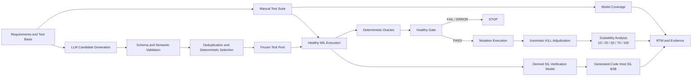

# AS2308 BLDC Speed PI Controller Verification Automation

MATLAB/Simulink 기반 **requirements-based SW Verification 자동화 프로젝트**입니다. AS2308 BLDC Speed PI Controller에 MIL, Oracle, Coverage, Mutation, scalability와 Host SIL B2B를 적용했습니다.

중심은 AI가 아니라 **SW Verification**입니다. LLM은 candidate만 생성하며 validation, selection, execution, Oracle과 adjudication은 deterministic code가 수행합니다.

## Key Results

| Verification area | Result |
|---|---:|
| Manual / Official AI Healthy MIL | **9/9 PASS / 9/9 PASS** |
| Manual Model Coverage | **Execution 10/10, Decision 4/4** |
| Frozen 6-mutant set | **Manual 6/6, AI 6/6 killed** |
| Manual / AI kill cells | **14/54 / 18/54** — 동일 9-execution budget |
| Scalability Healthy MIL | **100/100 PASS** |
| Scalability execution | **700 simulations, execution error 0, automatic retry 0, 약 150.6 s** |
| Scalability kill cells | **Budget 10: 12/60 → Budget 100: 156/600** |
| Source-to-Derived Gate | **Stage A 3/3, Stage B 3/3 PASS; observed diff 0** |
| Independent Host SIL Phase B | **15/15 PASS** |
| Worst Host SIL difference | **Vcmd 0 V, MotorSpeed 0 rps** |

## Verification Workflow



## System Under Test

| Item | Frozen configuration |
|---|---|
| DUT / Plant | Speed PI Controller / `G(s) = 2185.96 / (s + 17.76)` |
| Reference path | `SpeedRef [rps] -> 2*pi -> Speed PI Controller` — prefilter 없음 |
| Parameters | `Kps ≈ 0.115`, `Kis ≈ 2.042`, `Kas = 17.76`, `Vdc = 12 V` |
| Simulation | Fixed-step `ode4`, `ts = 0.0004 s`, `double` |
| Environment | MATLAB R2023b / Simulink 23.2 |

`ts = 0.0004 s`는 integration step이지 verified `400 us` deadline이 아닙니다. Reduced-order Plant에는 current/PWM/encoder/electrical dynamics가 없습니다.

## MIL, Mutation and AI-Assisted Test Generation

Manual Dynamic Compliance Suite는 5 cases / 9 executions이며 **9/9 PASS**했습니다. Voltage, Tracking, Direction Oracle이 판정합니다. Static requirements는 frozen configuration/topology를 read-only로 확인했으며 Polyspace-style analysis가 아닙니다.

Frozen 6-mutant set은 Controller만 대상으로 하며 kill은 `Healthy PASS -> Mutant FAIL`입니다.

| Suite | Budget | Mutants killed | Kill cells |
|---|---:|---:|---:|
| Manual | 9 | 6/6 | 14/54 |
| Official AI | 9 | 6/6 | 18/54 |

V1 Official AI Suite에서는 25 candidates 모두 validation을 통과했고, 그중 9개를 deterministic하게 선택했습니다. 이후 별도의 Scalability Extension protocol에서 candidate pool을 확장해 frozen 100-case pool을 구성했습니다. 두 selection 모두 mutation/manual/coverage 결과를 입력으로 사용하지 않았으며, AI는 PASS/FAIL을 판단하지 않았습니다. 동일 9-execution budget에서 AI Suite가 4개 더 많은 kill cell을 기록했지만 일반화하지 않습니다. [Metadata](ai/output/ai_generation_metadata.json)

## Scalability Extension

Frozen 100-case ordering의 prefix budget을 비교했습니다. Healthy 100회 + Mutation 600회, 총 **700 simulations**을 error/retry 없이 완료했습니다.

| Budget | Mutants killed | Score | Kill cells | Density |
|---:|---:|---:|---:|---:|
| 10 | 6/6 | 100% | 12/60 | 20.00% |
| 25 | 6/6 | 100% | 36/150 | 24.00% |
| 50 | 6/6 | 100% | 77/300 | 25.67% |
| 75 | 6/6 | 100% | 115/450 | 25.56% |
| 100 | 6/6 | 100% | 156/600 | 26.00% |


Mutation Score는 budget 10에서 이미 100%였고 first kill은 모두 index 5 이내였습니다. 이후 TC는 새 mutant 종류 대신 여러 scenario에서 기존 fault를 반복 검출해 kill cells를 `12 → 156`으로 늘렸습니다. [상세 결과](docs/08_Scalability_Extension_Results.md)

### Automation Reliability

Scalability testing에서 기존 pulse-pattern runner의 hidden stimulus-shape assumption과 arbitrary piecewise-constant Test Case 간 contract mismatch를 preflight로 확인했습니다. Frozen source model을 수정하지 않는 generic `From Workspace` runtime harness를 도입했고, Healthy Gate에서 드러난 zero-intermediate reversal의 runner/Oracle execution-semantics mismatch는 previous non-zero plateau 기준 planning과 self-check로 명시했습니다. Frozen DUT, Oracles와 Test Pool은 변경하지 않았습니다.

## Host SIL Back-to-Back

Host SIL은 requirement 재판정이 아니라 **Model-Code numerical equivalence** 검증입니다.

- Source-to-Derived Stage A/B: 각각 `3/3 PASS`, observed difference `0`
- Independent Phase B: `15/15 PASS`, FAIL/error `0`
- Worst max absolute difference: `Vcmd = 0 V`, `MotorSpeed = 0 rps`

Observation-only ZOH는 feedback path에 없습니다. 범위는 Windows x86-64 GRT Host SIL입니다. [Protocol](docs/04_SIL_BackToBack_Protocol_v1.2.md) · [Final Report](docs/05_Final_Verification_Report.md)

## Supplemental Anti-Windup Characterization

> **Supplemental Characterization, not Requirement Compliance**

동일한 repeated `±15 rps` reversal에서 AW ON/OFF를 비교했습니다. AW OFF에서 max `|integrator output|`은 `23.44%`, reversal speed-error area는 `6.68%` 증가했지만 saturation duration과 zero-crossing delay는 동일했습니다.

Anti-windup의 integrator accumulation 억제 효과는 관찰됐지만, 이 frozen scenario에서 MotorSpeed response 개선은 상대적으로 제한적이었습니다. 이 평가는 `REQ-AW-001`의 dynamic compliance PASS가 아닙니다.

[Anti-Windup Characterization Results](docs/09_Anti_Windup_Characterization_Results.md)

## Repository Structure

```text
model/          MIL baseline and derived SIL model
requirements/   Requirements and environment constraints
runner/         MIL, Oracle, Coverage, Mutation and SIL automation
mutations/      Frozen Primary Mutation Set
ai/             Candidate generation, validation, selection and analysis
results/        Authoritative evidence and figures
docs/           Protocols, reports and traceability
```

## Documents and Evidence

- [Requirements](requirements/01_Requirements.md) · [Mutation Protocol](docs/03_Mutation_Adjudication_Protocol.md) · [SIL Protocol](docs/04_SIL_BackToBack_Protocol_v1.2.md)
- [Final Verification Report](docs/05_Final_Verification_Report.md) · [RTM](docs/06_Requirements_Traceability_Matrix.md)
- [Scalability Protocol](docs/07_AI_Verification_Scalability_Protocol.md) · [Results](docs/08_Scalability_Extension_Results.md) · [AW Supplemental](docs/09_Anti_Windup_Characterization_Results.md)
- [Budget summary](results/scalability_extension_v1/budget_effectiveness_summary.csv) · [Runtime](results/scalability_extension_v1/runtime_summary.csv) · [Kill matrix](results/scalability_extension_v1/mutation_kill_matrix.csv)
- [Manual mutation](results/manual_mutation_corrected_v1/manual_mutation_summary.csv) · [AI mutation](results/ai_mutation_corrected_v1/AI_Mutation_Summary.csv)
- [Source-to-Derived Gate](results/source_derived_equivalence_v1/gate_summary.csv) · [SIL Phase B](results/sil_b2b_phase_b_v1/evaluation_summary.csv)

## Scope and Limitations

- 결과는 frozen model, suites, mutants와 host environment에 한정됩니다.
- Coverage 100%는 결함 부재가 아닙니다.
- Mutation 결과를 다른 fault set이나 AI 일반 성능으로 일반화하지 않습니다.
- Host SIL PASS는 product PASS가 아닙니다.
- HIL, MCU, target compiler, WCET, `400 us` deadline, ADC/PWM/encoder/CAN은 검증하지 않았습니다.
- Anti-windup dynamic assessment에는 compliance threshold나 PASS/FAIL이 없습니다.
