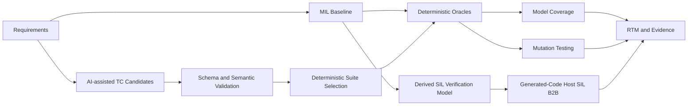

# AS2308 BLDC Speed PI Controller Verification

실제 AS2308 BLDC 실험 데이터에서 식별한 reduced-order plant를 이용해 Speed PI Controller를 검증한 프로젝트입니다. Requirements-based MIL, deterministic Oracle, Model Coverage, Mutation Testing, AI-assisted Test Case generation, generated-code Host SIL Back-to-Back을 하나의 추적 가능한 verification workflow로 구성했습니다.

프로젝트의 중심은 AI가 아니라 **SW Verification**입니다. LLM은 Test Case candidate 생성에만 사용했고, 선택·실행·판정·mutation adjudication은 deterministic code가 담당합니다.

## Key Results

| Verification area | Result |
|---|---:|
| Manual Healthy MIL | **9/9 PASS** |
| Official AI Healthy MIL | **9/9 PASS** |
| Manual Model Coverage | **Execution 10/10, Decision 4/4** |
| Condition / MC/DC | **N/A** — applicable objective 없음 |
| Manual Mutation | **6/6 killed, 14/54 kill cells** |
| AI Mutation | **6/6 killed, 18/54 kill cells** |
| Source-to-Derived Gate | **Stage A 3/3 PASS, Stage B 3/3 PASS, observed diff 0** |
| Independent SIL Phase B | **15/15 PASS** |
| Worst SIL difference | **Vcmd 0 V, MotorSpeed 0 rps** |

Manual/AI Mutation 결과는 동일한 DUT, Oracle, frozen 6-mutant set과 **각 9 top-level execution budget**에서 비교했습니다. 이 frozen experiment에서 AI Suite가 Manual Suite보다 4개 더 많은 kill cell을 기록했지만, 이를 AI의 일반적 우수성으로 해석하지 않습니다.

## Verification Workflow



```text
Actual experiment
  -> plant identification
  -> requirements-based MIL
  -> coverage + mutation
  -> Manual/AI Test Suite comparison
  -> generated-code Host SIL B2B
  -> traceability and evidence
```

## System Under Test / Environment

| Item | Frozen configuration |
|---|---|
| DUT | Speed PI Controller |
| Verification plant | `G(s) = 2185.96 / (s + 17.76)` |
| Plant origin | 실제 voltage/angular-velocity 실험 데이터로 식별한 first-order voltage-to-speed model |
| Reference path | `SpeedRef [rps] -> 2*pi -> Speed PI Controller` — reference prefilter 없음 |
| Controller parameters | `Kps ≈ 0.115`, `Kis ≈ 2.042`, `Kas = 17.76`, `Vdc = 12 V` |
| Solver | Fixed-step `ode4`, `ts = 0.0004 s`, `double` |
| Dynamics | Continuous PI Integrator + continuous identified plant |
| Verified environment | MATLAB R2023b / Simulink 23.2 |

`0.0004 s`는 이 모델의 **numerical integration step**입니다. Discrete controller period 또는 검증된 400 us real-time deadline을 의미하지 않습니다.

Plant는 speed-domain verification을 위한 reduced-order model입니다. 실제 motor의 current, PWM, encoder 및 detailed electrical transient 전체를 표현하는 모델이 아닙니다.

## Requirements-based MIL Verification

Frozen Requirements v1.1은 다음을 구분해 검증합니다.

- Dynamic: voltage limitation, constant tracking, bidirectional direction, direction reversal
- Static/configuration: speed-loop bandwidth, PI gain relation, anti-windup topology와 `Kas = Kis/Kps`
- Environment: sample step, identified plant, filter-free reference path, nominal SpeedRef domain

Dynamic PASS/FAIL은 MATLAB의 Voltage, Tracking, Direction Oracle과 Direction + Tracking 조합으로 판정했습니다. Manual Dynamic Suite는 5 logical Test Cases, 9 top-level executions이며 corrected healthy baseline에서 9/9 PASS입니다. Official AI Suite도 corrected adjudication 기준 9/9 PASS입니다.

Static Verification은 Polyspace-style code analysis가 아니라, **frozen source script와 Simulink configuration/topology에 대한 read-only static/configuration verification**입니다. `REQ-BW-001`, `REQ-PI-001`, `REQ-AW-001`의 static relation은 PASS했습니다. Anti-windup은 topology와 `Kas = Kis/Kps`만 static PASS로 확인했으며, dynamic recovery effectiveness를 공식 compliance PASS/FAIL로 판정하지 않았습니다.

## Mutation Testing: Manual vs AI

Frozen Primary Mutation Set은 integral path/gain, feedback sign, voltage-limit boundary, positive actuation fault 등 controller mutant 6개로 구성됩니다. Plant는 mutation 대상이 아닙니다.

| Suite | Mutants killed | Kill cells | Kill density |
|---|---:|---:|---:|
| Manual | 6/6 | 14/54 | 25.93% |
| Official AI | 6/6 | 18/54 | 33.33% |

Kill은 corrected protocol의 `Healthy PASS -> Mutant FAIL`일 때만 인정합니다. `INCONCLUSIVE_PRECONDITION`, `EXECUTION_ERROR`, `INVALID_MUTANT`은 kill이 아닙니다. 위 결과는 이 frozen Test Suite와 fault set에 한정됩니다.

## AI-assisted Test Generation

```text
Requirements + AI Test Basis + generation prompt
  -> LLM structured candidate generation
  -> schema and semantic validation
  -> 25 VALID candidates
  -> deterministic 9-test selection
  -> deterministic waveform resolution and MATLAB execution
  -> deterministic Oracles and mutation adjudication
```

LLM에는 Manual Test Cases, Mutation Set/Results, Coverage 결과를 제공하지 않았습니다. LLM은 candidate를 생성했을 뿐이며 다음 단계는 모두 deterministic code로 수행했습니다.

- Schema/semantic validation
- Requirement quota와 diversity 기반 suite selection
- Waveform resolution과 Simulink execution
- Oracle PASS/FAIL
- Mutation kill adjudication

25개 candidate를 생성해 25개 모두 validation을 통과했고, 그중 9개 Official AI Suite를 deterministic하게 선택했습니다. 세부 generation metadata는 [AI Generation Metadata](ai/output/ai_generation_metadata.json)에 기록되어 있으며, AI가 PASS/FAIL을 판정한 것은 아닙니다.

## SIL Back-to-Back

SIL은 product requirement를 다시 판정하는 단계가 아니라, **Normal model과 generated-code Host SIL의 Model-Code numerical equivalence**를 검증하는 단계입니다.

1. Frozen source를 수정하지 않고 external SpeedRef input과 observation-only ZOH outputs를 가진 derived verification model 생성
2. Source-to-Derived Gate
   - Stage A: source/derived closed-loop dynamics exact comparison — 3/3 PASS
   - Stage B: derived internal/sample output fidelity exact comparison — 3/3 PASS
3. Phase A: nominal, saturation, reversal 3개 scenario characterization — 모두 `EXECUTION_OK`, observed max/RMS diff 0
4. Phase B: Phase A scenario identity를 제외한 15개 independent scenario — 15/15 PASS

Phase B에서 `sampled_Vcmd`와 `sampled_MotorSpeed`의 worst max absolute difference는 각각 `0 V`, `0 rps`였습니다. 이 결과의 범위는 R2023b, Windows x86-64, GRT, `double`, fixed-step `ode4` Host SIL입니다.

검증하지 않은 범위: HIL, Arduino Due/target MCU, target compiler equivalence, WCET, 400 us real-time deadline, interrupt scheduling, ADC, PWM, encoder, CAN, production ECU.

## Repository Structure

```text
AS2308_AI_Verification/
├─ model/          Simulink MIL baseline and derived SIL verification model
├─ requirements/   Frozen requirements and environment constraints
├─ runner/         MIL, Oracle, Coverage, Mutation and SIL runners
├─ mutations/      Frozen Primary Mutation Set
├─ ai/             Test Basis, schema, validator, selector and AI artifacts
├─ results/        Corrected/frozen verification evidence
└─ docs/           Protocols, final report and traceability matrix
```

## Detailed Documents and Evidence

### Core documents

- [Requirements v1.1](requirements/01_Requirements.md)
- [Test Plan](docs/02_Test_Plan.md)
- [Mutation Adjudication Protocol v1.0](docs/03_Mutation_Adjudication_Protocol.md)
- [SIL B2B Protocol v1.2](docs/04_SIL_BackToBack_Protocol_v1.2.md)
- [Final Verification Report](docs/05_Final_Verification_Report.md)
- [Requirements Traceability Matrix](docs/06_Requirements_Traceability_Matrix.md)

### Key evidence

- [Static Requirement Verification](results/static_requirement_verification_v1/static_verification_summary.csv)
- [Manual Corrected Mutation Summary](results/manual_mutation_corrected_v1/manual_mutation_summary.csv)
- [AI Corrected Mutation Summary](results/ai_mutation_corrected_v1/AI_Mutation_Summary.csv)
- [Manual Coverage Summary](results/manual_suite_v1_coverage_summary.csv)
- [Source-to-Derived Gate](results/source_derived_equivalence_v1/gate_summary.csv)
- [SIL Phase A Summary](results/sil_b2b_characterization_v1_1/characterization_summary.csv)
- [SIL Phase B Summary](results/sil_b2b_phase_b_v1/evaluation_summary.csv)
- [AI Generation Metadata](ai/output/ai_generation_metadata.json)
- [AI Suite Selection Summary](ai/output/ai_suite_v1_selection_summary.csv)

## Scope and Limitations

- 본 결과는 frozen requirements, model, Test Suites, mutant set과 host environment에 한정됩니다.
- Coverage 100%는 결함 부재나 requirement 충족을 의미하지 않습니다.
- Mutation score와 kill-cell 차이는 사용한 fault set 밖으로 일반화하지 않습니다.
- SIL PASS는 generated-code Host Model-Code equivalence evidence이며 product requirement PASS, target processor 검증 또는 HIL 결과가 아닙니다.
- Anti-windup dynamic recovery effectiveness에는 공식 compliance threshold나 PASS/FAIL을 부여하지 않았습니다.
- 상세 수치, adjudication semantics와 evidence provenance는 [Final Verification Report](docs/05_Final_Verification_Report.md)와 [Requirements Traceability Matrix](docs/06_Requirements_Traceability_Matrix.md)를 기준으로 합니다.
