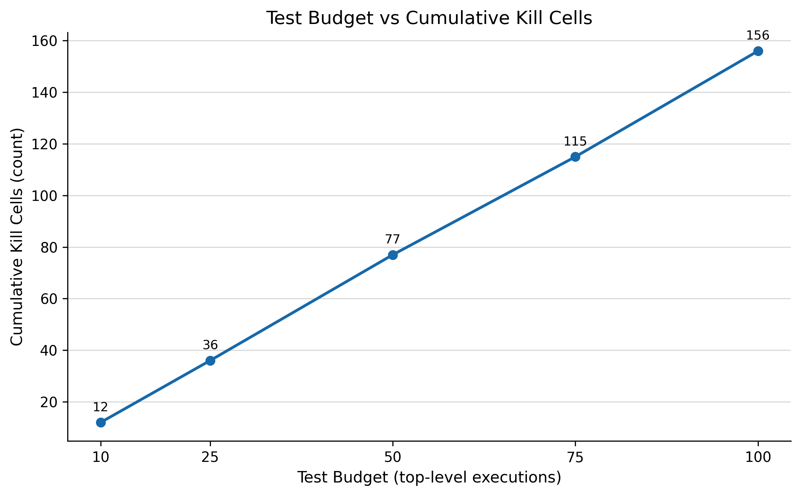
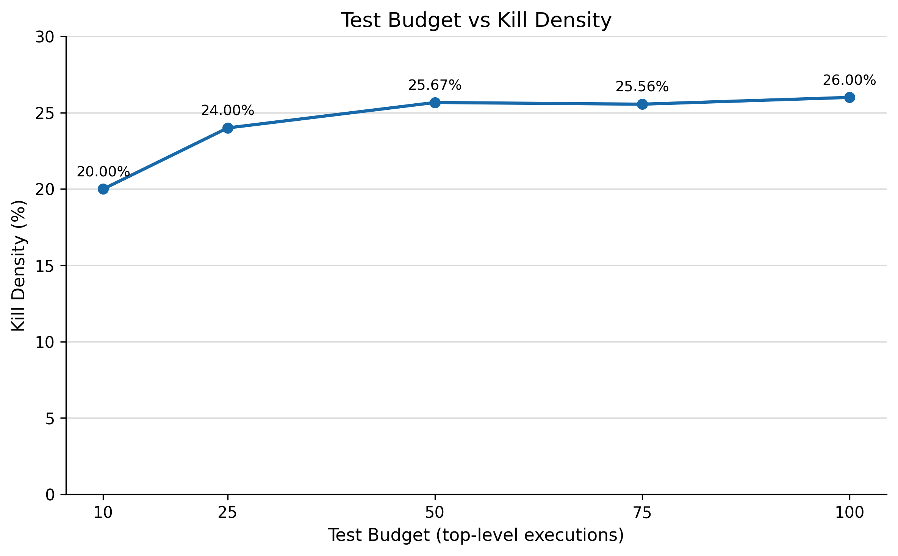
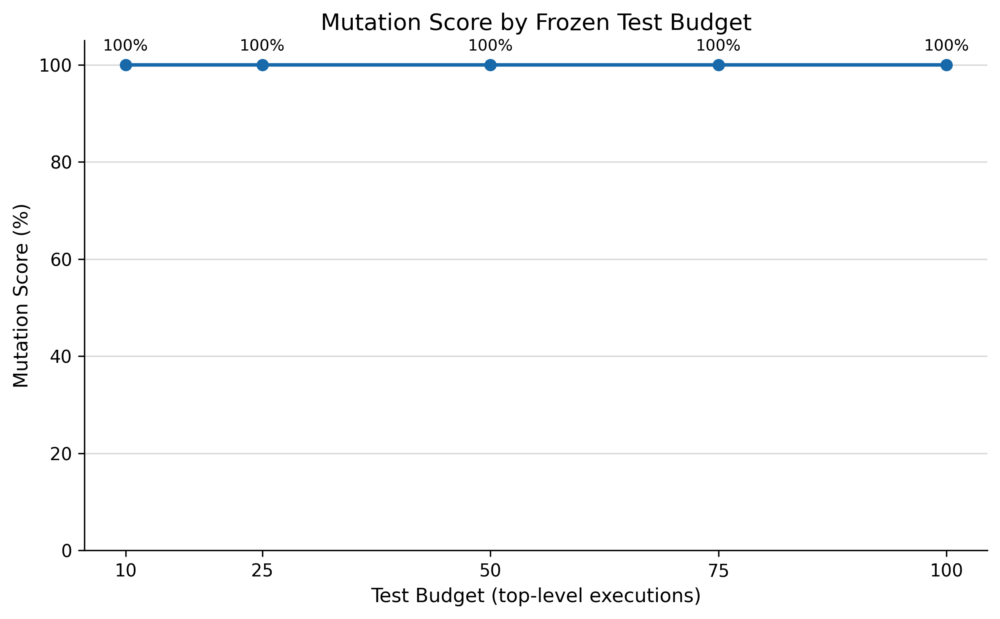
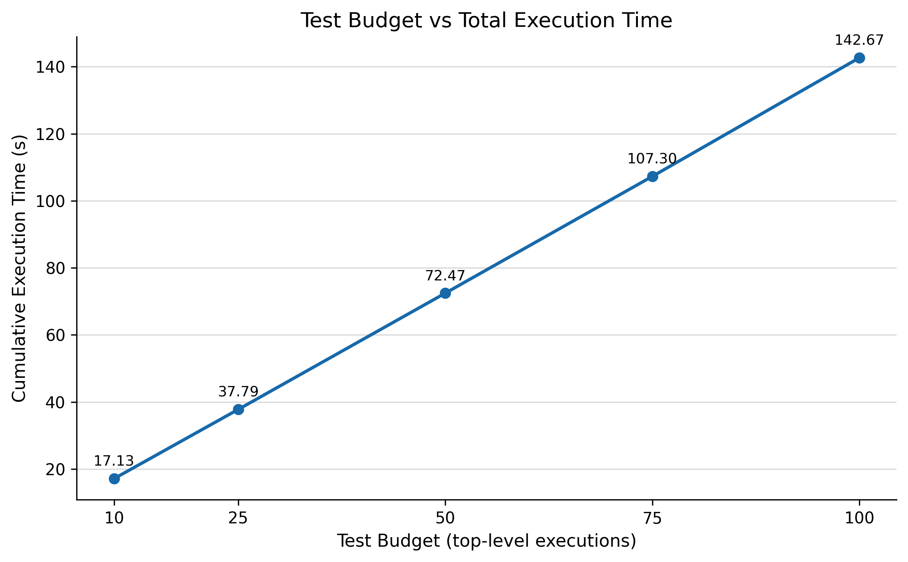

# AS2308 AI Verification Scalability Extension Results

## 1. Objective

본 extension은 frozen AI-assisted Test Case pool의 ordered prefix를 `10`, `25`, `50`, `75`, `100`개로 확대하면서 Healthy MIL 결과, frozen mutation set 검출 결과와 automation runtime을 정량적으로 관찰한다. 각 budget에서 Test Case를 다시 선택하거나 재정렬하지 않았으며, 모든 수치는 기존 result CSV를 사후 분석한 결과다.

## 2. Experimental Setup

- Protocol: `docs/07_AI_Verification_Scalability_Protocol.md` v1.1 Amended
- Model: `model/AS2308_MIL_Baseline_v3.slx`
- MATLAB / Simulink: R2023b
- Solver: fixed-step `ode4`
- Numerical integration step: `ts = 0.0004 s`
- Frozen pool: 100 top-level Test Cases
- Mutation set: `MUT-001`~`MUT-006`
- Segment duration: `2.0 s`
- Terminal evaluation window: `0.05 s`
- Budget rule: 동일 frozen ordering의 prefix `10/25/50/75/100`

실행 metadata에 기록된 frozen pool SHA-256은 `C53FDB14FC32D436284E0C2978A6628365F2148C29F6144939AF7D0C95272CCC`이다. Simulation, Oracle 및 mutation 판정은 deterministic runner가 수행했으며 본 문서 작성 과정에서는 재실행하지 않았다.

## 3. Healthy Baseline Result

Healthy MIL은 frozen 100 Test Cases 전체에서 `100/100 PASS`였다. Healthy FAIL, `INCONCLUSIVE_PRECONDITION`, `EXECUTION_ERROR`는 모두 0이었다. 따라서 100개 모두 mutation-eligible Test Case로 사용되었다.

## 4. Mutation Execution Result

6개 frozen mutant에 대해 Healthy PASS Test Case 100개를 실행하여 총 600개 mutation execution을 기록했다. 전체 6개 mutant가 적어도 하나의 Test Case에서 kill되었으며 전체 kill cell은 `156/600`이다. Mutation execution error는 0이었다. Mutant 실행 중 `INCONCLUSIVE_PRECONDITION` cell은 97개이며 kill로 계산하지 않았다.

Healthy 100회와 mutation 600회를 합한 총 simulation 수는 700회다. Automatic retry는 0이며 최종 `completion_status`는 `COMPLETED`다.

## 5. Budget Effectiveness

| Test budget | Mutants killed | Mutation score | Kill cells | Kill density |
|---:|---:|---:|---:|---:|
| 10 | 6/6 | 100% | 12/60 | 20.00% |
| 25 | 6/6 | 100% | 36/150 | 24.00% |
| 50 | 6/6 | 100% | 77/300 | 25.67% |
| 75 | 6/6 | 100% | 115/450 | 25.56% |
| 100 | 6/6 | 100% | 156/600 | 26.00% |

Mutation Score는 공식 frozen budget 중 가장 작은 10-case budget에서 이미 `100%`였다. 따라서 budget 10에서 100으로 증가할 때 Mutation Score가 향상됐다고 해석하지 않는다. Kill cells는 `12 → 36 → 77 → 115 → 156`으로 증가했다. Kill density는 `20.00% → 24.00% → 25.67% → 25.56% → 26.00%`였으며, budget 75에서 소폭 낮아진 뒤 budget 100에서 26.00%를 기록했다.

## 6. First Kill Analysis

모든 valid mutant는 ordered index 5 이내에서 처음 검출되었다. 공식 frozen budget 기준으로는 budget 10에서 6개 mutant 모두 최소 한 번 kill되었다.

| Mutant | First kill index | First killing candidate | Total kill cells within 100 |
|---|---:|---|---:|
| MUT-001 | 2 | `EXT-B04-TC-008` | 27 |
| MUT-002 | 2 | `EXT-B04-TC-008` | 44 |
| MUT-003 | 2 | `EXT-B04-TC-008` | 28 |
| MUT-004 | 5 | `EXT-B01-CAND-025` | 9 |
| MUT-005 | 5 | `EXT-B01-CAND-025` | 9 |
| MUT-006 | 2 | `EXT-B04-TC-008` | 39 |

Index 5 이후 Test Case는 새로운 mutant 종류를 처음 발견하지 않았다. 다만 이미 검출된 fault를 다른 scenario에서도 반복 검출하여 누적 kill cells를 증가시켰다.

## 7. Runtime

End-to-end execution metadata는 다음과 같다.

- Healthy elapsed time: `22.8507224 s`
- Mutation elapsed time: `127.7551613 s`
- Total simulation elapsed time: `150.6058837 s`
- Average execution time: `0.2151512624 s`
- Total simulations: 700
- Execution errors: 0
- Automatic retries: 0

Figure 4는 `budget_effectiveness_summary.csv`의 `total_elapsed_time_s`를 사용한다. 이는 각 budget prefix에 포함된 completed execution의 elapsed time 합계다. Budget 100의 값은 `142.6709652 s`이며, orchestration을 포함한 `runtime_summary.csv`의 end-to-end total simulation elapsed time `150.6058837 s`와 정의가 다르다. 이 runtime은 host automation 실행시간이며 WCET, target MCU timing 또는 real-time deadline 측정값이 아니다.

## 8. Interpretation

이 frozen experiment에서는 Mutation Score가 10-case budget에서 이미 포화했다. 추가 Test Case는 새로운 mutant 종류를 발견하지 않았지만, 다양한 scenario에서 기존 fault를 반복 검출하여 kill cells를 `12`에서 `156`으로 증가시켰다. Kill density도 약 20%~26% 범위에서 유지됐으며 최종 budget에서 26%를 기록했다.

따라서 이 결과는 frozen six-mutant set에 대해 Test Case 수 증가가 신규 mutant discovery보다 기존 fault의 scenario-level detection breadth를 늘렸음을 보여준다. 이는 AI-generated Test Case의 일반적 우수성, 100개 Test Case의 필요성 또는 Test Case 수가 늘면 항상 verification quality가 개선된다는 결론을 의미하지 않는다.

## 9. Limitations

- 결론은 현재 model, frozen 100-case ordering, six-mutant set, Oracle과 execution environment에 한정된다.
- Mutation Score 100%는 정의된 6개 mutant가 최소 한 번 검출됐다는 의미이며 모든 가능한 fault 검출을 의미하지 않는다.
- Kill cell 증가는 동일 fault가 여러 scenario에서 검출된 횟수이며 새로운 fault class의 발견 횟수가 아니다.
- 본 분석은 기존 CSV의 사후 집계다. 새로운 MIL simulation, mutation execution 또는 AI generation을 수행하지 않았다.
- Host runtime은 실제 MCU, target compiler, WCET 또는 `400 us` real-time deadline을 검증하지 않는다.

## 10. Evidence

- `results/scalability_extension_v1/budget_effectiveness_summary.csv`
- `results/scalability_extension_v1/per_mutant_first_kill.csv`
- `results/scalability_extension_v1/per_test_detection_summary.csv`
- `results/scalability_extension_v1/runtime_summary.csv`
- `results/scalability_extension_v1/healthy_execution_results.csv`
- `results/scalability_extension_v1/mutation_execution_results.csv`
- `results/scalability_extension_v1/mutation_kill_matrix.csv`
- `results/scalability_extension_v1/metadata.txt`
