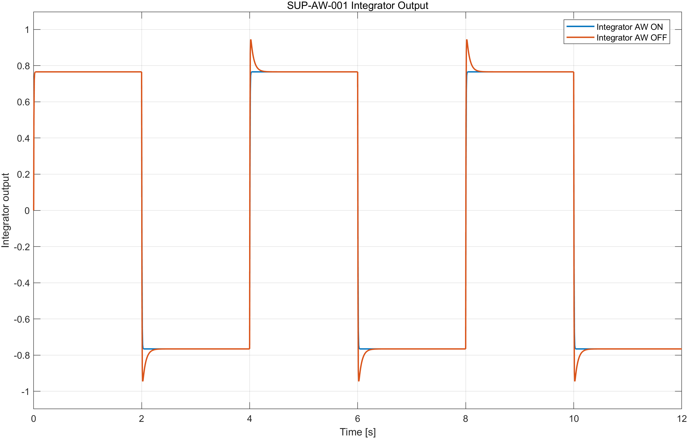
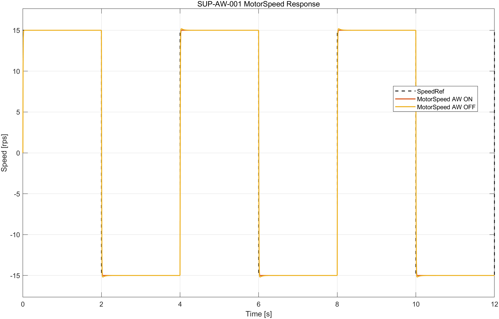

# SUP-AW-001 Anti-Windup Dynamic Effectiveness Assessment

> **Supplemental Characterization, not Requirement Compliance**

## 1. Objective

본 평가는 frozen `AS2308_MIL_Baseline_v3`에서 anti-windup feedback ON/OFF에 따른 integrator state와 MotorSpeed response의 동적 차이를 정량적으로 관찰한다. 새로운 Compliance Oracle, PASS/FAIL threshold 또는 product requirement를 정의하지 않는다.

## 2. Experimental Setup

| Item | Configuration |
|---|---|
| Model | `model/AS2308_MIL_Baseline_v3.slx` |
| AW ON | `Gain2 = 1` |
| AW OFF comparison | `Gain2 = 0` |
| Kas | `Kis/Kps = 17.76`, 두 조건에서 동일 |
| SpeedRef | repeated `+15/-15 rps` |
| Plateau duration | `2.0 s` |
| Repeat count | 3 (`6` plateaus, `5` sign reversals) |
| Solver | Fixed-step `ode4` |
| Numerical integration step | `ts = 0.0004 s` |
| Terminal evaluation window | 각 reversal target plateau 마지막 `0.05 s` |
| Simulations | AW ON 1회 + AW OFF 1회 |
| Automatic retries | 0 |

`Gain2 = 0`은 정상 운용 configuration이 아니라 anti-windup feedback 효과를 비교하기 위한 조건이다. 다른 Controller 및 Plant parameter는 변경하지 않았다. Source model SHA-256은 실행 전후 모두 `4A7FDC070506CA641ACBD2C3EFEA2FEF71DDCC150CA3FC1F20F191B8B998ED4D`였다.

## 3. Metrics

### Integrator-centered metrics

- `max_abs_integrator_output`: simulation 전체에서 integrator output 절댓값의 최댓값
- `saturation_duration_s`: `raw_pi_output`이 `+12 V`보다 크거나 `-12 V`보다 작은 구간의 누적시간
- `mean_abs_integrator_at_saturation_exit`: saturation exit sample에서 `abs(integrator_output)`의 event 평균
- `post_saturation_abs_integrator_area`: 각 saturation exit부터 해당 plateau end까지 `abs(integrator_output)` 적분의 합
- `post_saturation_integrator_deviation_area`: 각 saturation exit부터 plateau-end integrator value에 대한 절대 편차 적분의 합

### MotorSpeed metrics

- `zero_crossing_delay_s`: reference sign reversal boundary부터 MotorSpeed가 새 reference sign으로 처음 진입할 때까지의 시간. Speed tolerance는 사용하지 않았다.
- `post_reversal_speed_error_area_rps_s`: reversal boundary부터 target plateau end까지 `abs(reference - motorspeed)`를 적분한 값
- `mean_abs_terminal_tracking_error_rps`: target plateau 마지막 `0.05 s`에서 `mean(abs(reference - motorspeed))`
- `plateau_end_abs_tracking_error_rps`: target plateau end에서의 `abs(reference - motorspeed)`

모든 metric은 descriptive measurement이며 acceptance criterion이 아니다.

## 4. Integrator Behavior

| Metric | AW ON | AW OFF | AW OFF relative to AW ON |
|---|---:|---:|---:|
| Max absolute integrator output | 0.765723327889 | 0.945224330726 | +23.44% |
| Saturation duration | 0.0162 s | 0.0162 s | 0.00% |
| Mean absolute integrator at saturation exit | 0.0608894046132 | 0.179646764274 | +195.04% |
| Post-saturation absolute integrator area | 7.62864468375 | 7.70094670578 | +0.95% |
| Post-saturation integrator deviation area | 0.0164588007064 | 0.0676687408758 | +311.14% |

두 조건의 saturation sample count는 각각 41개이고 saturation duration은 모두 `0.0162 s`로 동일했다. AW OFF에서는 max absolute integrator output과 saturation exit 시점의 absolute integrator state가 더 컸다. Post-saturation integrator deviation area도 AW OFF에서 더 컸다. 이 값은 동일한 saturation duration에서도 integrator trajectory가 달랐음을 보여주는 descriptive evidence다.

`mean_integrator_deviation_at_saturation_exit`도 CSV에 유지했지만, 부호 및 plateau-end 기준에 따라 직관적 해석이 제한되므로 핵심 결론에는 사용하지 않았다.

## 5. MotorSpeed Behavior

각 조건에서 5개의 실제 sign reversal을 측정했다. 모든 event에서 target plateau 안에 MotorSpeed zero crossing이 존재했다.

| Metric | AW ON | AW OFF | AW OFF relative to AW ON |
|---|---:|---:|---:|
| Reversal event count | 5 | 5 | 0.00% |
| Mean zero-crossing delay | 0.0036 s | 0.0036 s | 0.00% |
| Maximum zero-crossing delay | 0.0036 s | 0.0036 s | 0.00% |
| Mean post-reversal speed-error area | 0.138173717871 rps·s | 0.147406003654 rps·s | +6.68% |
| Total post-reversal speed-error area | 0.690868589354 rps·s | 0.737030018271 rps·s | +6.68% |
| Mean terminal absolute tracking error | 1.06581e-14 rps | 8.88178e-15 rps | numerical-zero scale |
| Maximum terminal absolute tracking error | 1.06581e-14 rps | 8.88178e-15 rps | numerical-zero scale |
| Mean plateau-end absolute tracking error | 1.06581e-14 rps | 8.88178e-15 rps | numerical-zero scale |

Zero-crossing delay는 두 조건에서 동일했다. AW OFF의 post-reversal speed-error area는 AW ON보다 `0.00923228578 rps·s`, 약 `6.68%` 컸다. Terminal 및 plateau-end tracking residual은 두 조건 모두 약 `1e-14 rps`의 numerical-zero scale이었다. 따라서 이 scenario에서 관찰된 MotorSpeed response 차이는 integrator metric 차이에 비해 작았다.

Terminal residual의 percentage는 매우 작은 numerical residual을 분모로 사용하므로 물리적 효과 크기로 해석하지 않았다.

## 6. Interpretation

동일한 repeated `+15/-15 rps` scenario에서 AW ON과 AW OFF는 같은 saturation duration과 zero-crossing delay를 보였다. AW ON에서는 max absolute integrator output, saturation exit 시점의 integrator magnitude 및 post-saturation deviation area가 더 작았다. MotorSpeed에서는 AW OFF의 post-reversal error area가 약 `6.68%` 컸지만 zero-crossing delay와 terminal tracking은 실질적으로 같았다.

따라서 본 결과는 anti-windup feedback이 integrator accumulation과 post-saturation integrator trajectory에 미친 차이를 명확히 보여준다. 다만 이 frozen scenario의 MotorSpeed recovery가 크게 개선됐다고 표현할 근거는 없으며, 측정된 speed-response 차이는 제한적이었다.

## 7. Limitations

- 본 결과는 `Gain2`만 변경한 frozen repeated reversal scenario에 한정된다.
- 본 평가는 supplemental characterization이며 `REQ-AW-001`에 대한 dynamic compliance PASS/FAIL 판정이 아니다.
- Zero-crossing delay는 exact sign 진입을 사용하며 별도의 speed magnitude 또는 settling threshold를 포함하지 않는다.
- `0.05 s` terminal window는 기존 project evaluation convention이며 새로운 product requirement가 아니다.
- 현재 reduced-order voltage-to-speed Plant는 current/PWM/encoder/electrical/thermal dynamics 또는 physical motor를 검증하지 않는다.
- Host simulation 결과는 target MCU, WCET 또는 real-time deadline 검증이 아니다.

## 8. Evidence

- `results/anti_windup_characterization_v1/condition_metrics.csv`
- `results/anti_windup_characterization_v1/reversal_event_metrics.csv`
- `results/anti_windup_characterization_v1/comparison_metrics.csv`
- `results/anti_windup_characterization_v1/aw_on_samples.csv`
- `results/anti_windup_characterization_v1/aw_off_samples.csv`
- `results/anti_windup_characterization_v1/metadata.txt`
